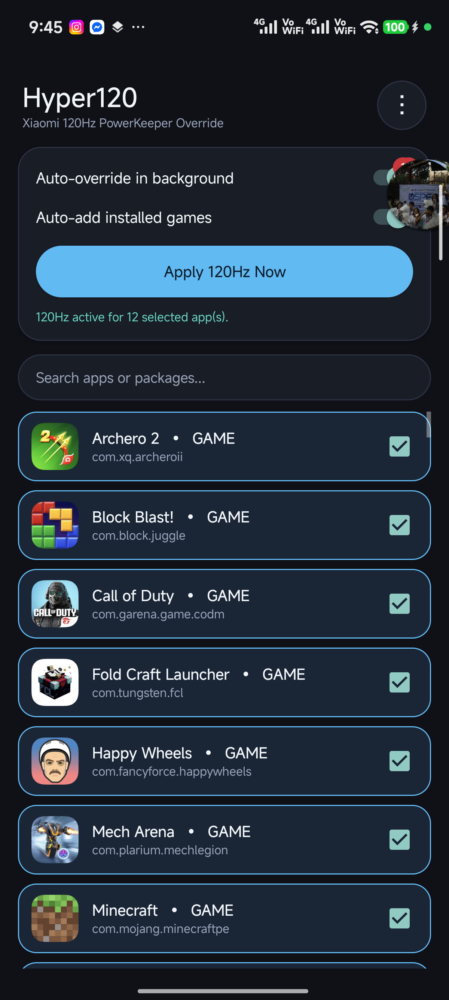
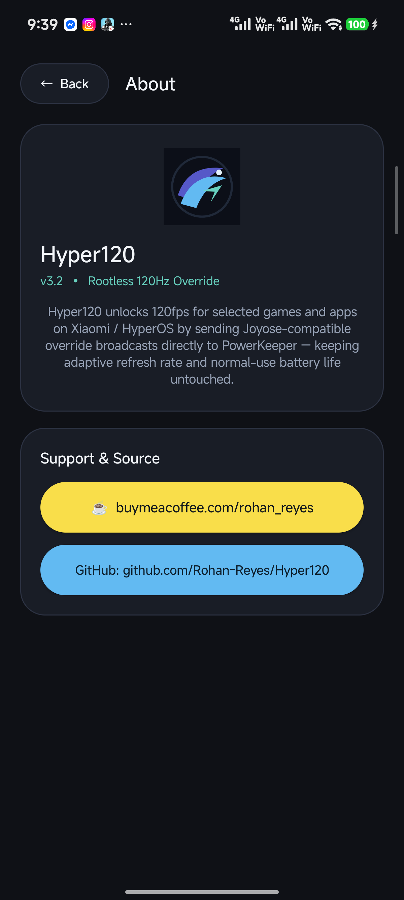
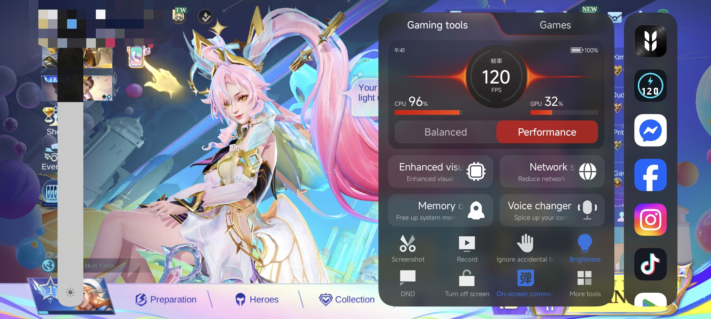
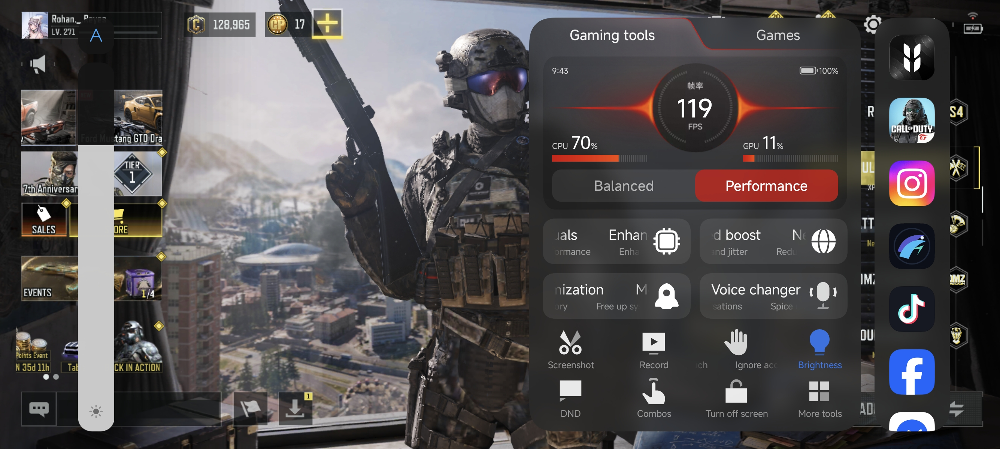
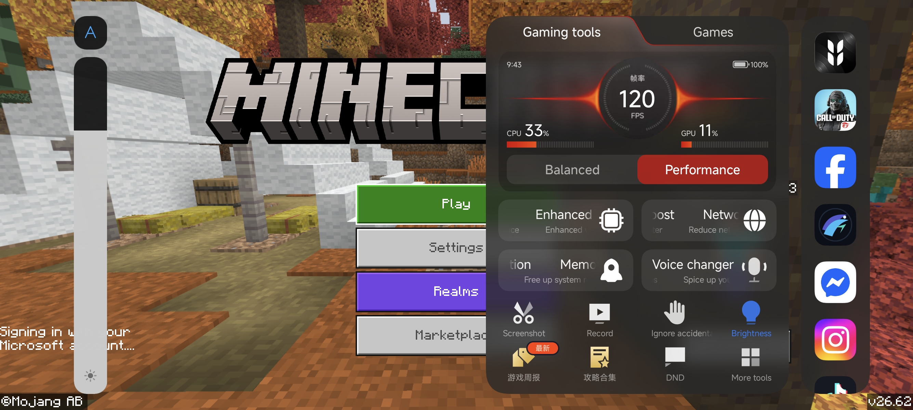
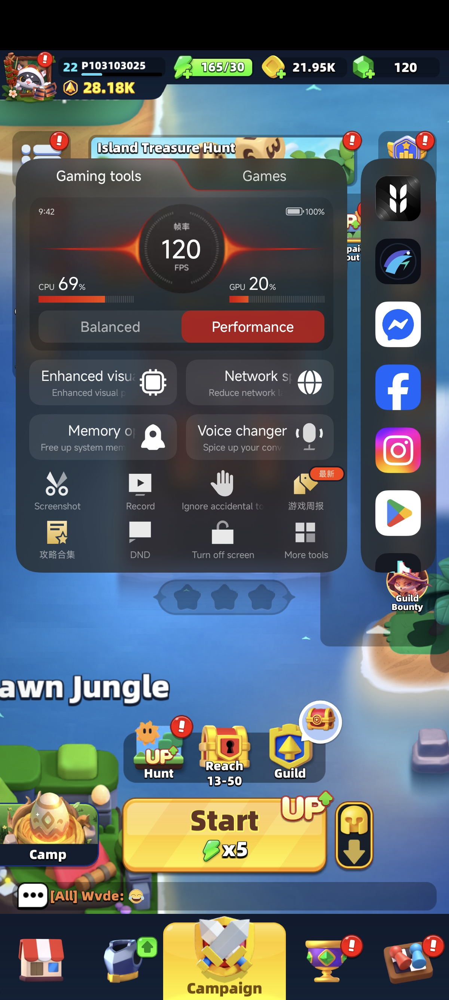

# Hyper120

**The easiest, most consistent rootless 120Hz fix for Xiaomi / HyperOS.**

Unlike other workarounds that force you to disable `com.miui.powerkeeper` (hurting daily battery life), root your phone, or keep a PC connected, **Hyper120** unlocks **120fps** for your chosen games while keeping PowerKeeper and adaptive refresh rate (`is_smart_fps=1`) **100% enabled** for normal use.

---

## Why Hyper120 Is the Easiest & Most Consistent Fix

- **No Root Required:** Installs like a normal Android app.
- **No PC Needed After Install:** Runs on-device, auto-starts on boot (`BOOT_COMPLETED`), and keeps your 120Hz overrides active in the background.
- **Auto-Add Installed Games:** Automatically detects existing and newly installed games (`PACKAGE_ADDED`) and adds them to 120Hz (while remembering any game you manually uncheck).
- **Zero Normal-Use Battery Trade-off:** PowerKeeper stays enabled and adaptive refresh rate still drops to 60Hz/idle in regular apps.
- **Consistent Against Resets:** Periodically refreshes PowerKeeper's `mPrivGames` map while your screen is on so games stay locked at 120Hz.
- **Simple App Picker:** Search and check any installed game or app — no manual package typing or ADB commands required.

---

## How to Install

### Option A: Directly on Your Phone (No PC)
1. Download **`Hyper120.apk`** from the [Releases](https://github.com/Rohan-Reyes/Hyper120/releases) page.
2. Open the downloaded APK and allow **Install from unknown sources** if prompted.
3. Launch **Hyper120** — it automatically detects your installed games and applies 120Hz.
4. *(Recommended on HyperOS / MIUI)* Long-press **Hyper120** → **App info**:
   * Enable **Autostart**
   * Set **Battery saver** to **No restrictions**

### Option B: Via ADB (Optional)
```bash
adb install -r Hyper120.apk
adb shell dumpsys deviceidle whitelist +com.custom.game120hz
adb shell appops set com.custom.game120hz RUN_ANY_IN_BACKGROUND allow
```

---

## Screenshots

| Main App Picker | About & Support |
| :---: | :---: |
|  |  |

### Recent In-Game Screenshots

| Mobile Legends: Bang Bang | Call of Duty: Mobile |
| :---: | :---: |
|  |  |

| Minecraft | Archero 2 |
| :---: | :---: |
|  |  |

---

## Proof of 120Hz Working (Xiaomi 14 / `houji`, Android 16)

Before **Hyper120**, `com.miui.powerkeeper` (`DisplayFrameSetting`) placed `com.mobile.legends` into `mDefaultGameApp(60)` and clamped the display to `modeId 2` (`60.000004` Hz):

```text
mDisplayModeSpecs={baseModeId=2 ... render: (0.0 60.0)}
mActiveRenderFrameRate=60.000004
```

With **Hyper120** active (and `PowerKeeper` + `is_smart_fps=1` **still enabled**), `dumpsys` confirms PowerKeeper's `mPrivGames` is populated and the display switches to **`120.00001` Hz** (`baseModeId=1`) while Mobile Legends is in the foreground:

```text
mDisplayModeSpecs={baseModeId=1 allowGroupSwitching=false primary=physical: (0.0 Infinity) render: (0.0 120.0) appRequest=physical: (0.0 Infinity) render: (0.0 120.0) idleScreenRefreshRateConfig=null}
mActiveRenderFrameRate=120.00001
fpsconfig mPrivGames={com.roblox.client=120, com.tungsten.fcl=120, com.block.juggle=120, org.ppsspp.ppssppgold=120, com.fancyforce.happywheels=120, com.mobile.legends=120, com.gabama.monopostolite=120, com.xq.archeroii=120, com.mojang.minecraftpe=120, com.plarium.mechlegion=120, com.garena.game.codm=120, com.StefMorojna.SpaceflightSimulator=120}
```

---

## How It Works

On HyperOS / MIUI, `com.miui.powerkeeper` (`DisplayFrameSetting`) checks `mPrivGames` and `mDefaultGameApp(60)` whenever an app enters the foreground. Games in `mDefaultGameApp(60)` get clamped to 60Hz via `DisplayFeatureManager.setScreenEffect(...)`.

**Hyper120** sends `com.xiaomi.joyose.OVERRIDE_GAME_FRESHRATE` (`override_pkg_name`, `override_freshrate=120`) directly to `com.miui.powerkeeper`, registering your selected apps in `mPrivGames` at `120` without disabling PowerKeeper.

---

## Support

- **Buy Me a Coffee:** https://buymeacoffee.com/rohan_reyes
- **GitHub:** https://github.com/Rohan-Reyes/Hyper120
