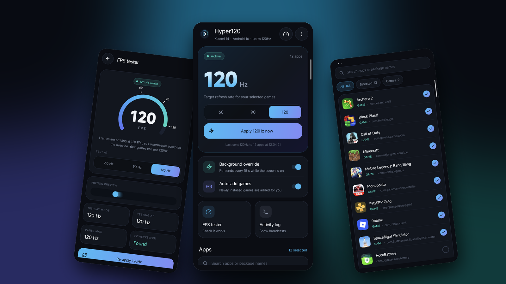
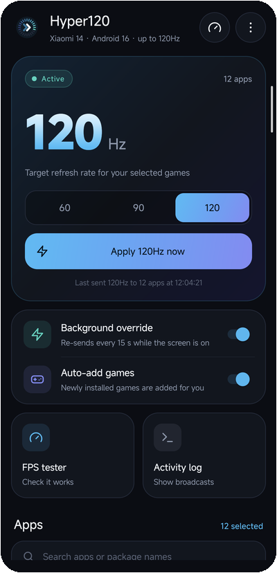
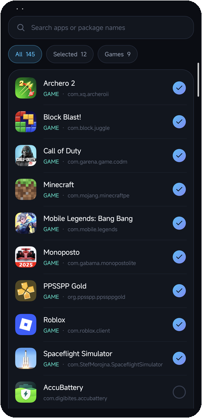
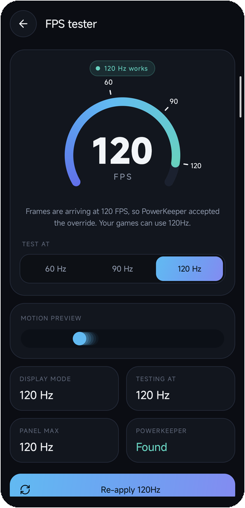
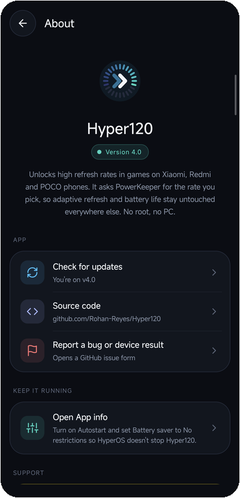

<div align="center">


# Hyper120

**Play at 90, 120 or 144Hz on Xiaomi, Redmi and POCO. No root, no PC, no battery trade-off.**

[](https://github.com/Rohan-Reyes/Hyper120/releases/latest)
[](https://github.com/Rohan-Reyes/Hyper120/releases/latest)
[](#does-it-work-on-my-phone)
[](#how-it-works)

[**Download the APK**](https://github.com/Rohan-Reyes/Hyper120/releases/latest) · [Website](https://hyper120.aten-systems.site) · [Add to Obtainium](https://apps.obtainium.imranr.dev/redirect.html?r=obtainium://app/%7B%22id%22%3A%22com.custom.game120hz%22%2C%22url%22%3A%22https%3A%2F%2Fgithub.com%2FRohan-Reyes%2FHyper120%22%2C%22author%22%3A%22Rohan-Reyes%22%2C%22name%22%3A%22Hyper120%22%7D) · [Report your device](https://github.com/Rohan-Reyes/Hyper120/issues/new/choose)



</div>

## Why Hyper120

HyperOS and MIUI quietly cap many games at **60Hz**, even when your screen is set to 120Hz. The usual fixes cost you something: disabling PowerKeeper drains the battery, root voids your warranty, and ADB tricks reset on reboot.

- **Only your games go fast.** Hyper120 asks PowerKeeper (the system service that sets the cap) to unlock the rate you pick for the apps you pick. Everything else keeps adaptive refresh and drops to 60Hz or lower as usual.
- **Set it once.** It starts on boot, adds new games when you install them, and re-sends the override every 15 seconds while the screen is on, so the cap doesn't creep back.
- **Proof built in.** The FPS tester switches the screen to each rate and measures the frames that actually arrive, then tells you whether your phone supports it.

## Screenshots

<table>
  <tr>
    <td align="center"><br><sub><b>Home</b><br>Pick 60 / 90 / 120 / 144Hz</sub></td>
    <td align="center"><br><sub><b>Apps</b><br>Games are found automatically</sub></td>
    <td align="center"><br><sub><b>FPS tester</b><br>Live check with a verdict</sub></td>
    <td align="center"><br><sub><b>About</b><br>Updates, setup help, support</sub></td>
  </tr>
</table>

<details>
<summary><b>In-game screenshots</b> (Xiaomi 14, HyperOS, PowerKeeper on)</summary>
<br>

| Mobile Legends: Bang Bang | Call of Duty: Mobile |
| :---: | :---: |
|  |  |
| **Minecraft** | **Archero 2** |
|  |  |

</details>

## Features

| | |
|---|---|
| **Per-app refresh rate** | Choose any rate your panel supports (detected from the display: 60, 90, 120, 144Hz). Only the apps you tick get it. |
| **Auto-add games** | Installed games are ticked on first launch, and new ones are added the moment you install them. Untick a game and it stays unticked. |
| **Background override** | A small foreground service re-sends the override every 15 s while the screen is on and again after every reboot. |
| **FPS tester** | Points the override at Hyper120 itself, asks for the matching display mode and counts real frames. Test 60, 90 and 120Hz one after another to see exactly where your ROM stops. |
| **Game limit tags** | Known games are tagged `UP TO 120`, `90 MAX` or `60 MAX`, so you can tell when the game itself is the limit. Long-press for how to turn on its high frame rate. |
| **Quick Settings tile** | Turn the background override on or off from Control Center. The tile shows the current rate and app count. |
| **Activity log** | See each broadcast sent to PowerKeeper, with timestamps. |
| **Bug & device reports** | One tap opens a GitHub issue pre-filled with your device, Android version, panel max and tester result. |
| **Updates** | **About → Check for updates** looks at GitHub Releases. Obtainium works too. |

## Install

1. Download **Hyper120.apk** from the [latest release](https://github.com/Rohan-Reyes/Hyper120/releases/latest) on your phone, or add it to [Obtainium](https://apps.obtainium.imranr.dev/redirect.html?r=obtainium://app/%7B%22id%22%3A%22com.custom.game120hz%22%2C%22url%22%3A%22https%3A%2F%2Fgithub.com%2FRohan-Reyes%2FHyper120%22%2C%22author%22%3A%22Rohan-Reyes%22%2C%22name%22%3A%22Hyper120%22%7D) for automatic updates.
2. Open it and allow installs from unknown sources if asked.
3. Launch **Hyper120**. Your games are detected and unlocked straight away.
4. **Important on HyperOS:** open **About → Open App info**, turn on **Autostart** and set **Battery saver** to **No restrictions**. Otherwise HyperOS may stop the background service.

To go back to normal for a game, untick it (or pick 60Hz and tap Apply). PowerKeeper keeps the last value in memory until it restarts.

<details>
<summary>Optional: install and whitelist with ADB</summary>

```bash
adb install -r Hyper120.apk
adb shell dumpsys deviceidle whitelist +com.custom.game120hz
adb shell appops set com.custom.game120hz RUN_ANY_IN_BACKGROUND allow
```
</details>

## Does it work on my phone?

Open the **FPS tester** (gauge icon, top right). It runs the override against itself, so the result is what your games will get.

| Status | Devices |
|---|---|
| ✅ **Verified** | Xiaomi 14 (`houji`), HyperOS / Android 16, China ROM: 60, 90 and 120Hz all confirmed |
| 🟡 **Likely** (untested) | Xiaomi 15 / 14 / 13 / 12 series incl. T and Ultra · Redmi K80 / K70 / K60 / K50, Note 14 / 13 / 12 Pro & Turbo · POCO F6 / F5 / X7 / X6 · Xiaomi Pad 6 / 7 series |
| ❌ **Reported not working** | POCO M6 Pro 5G (Global HyperOS stays at 60Hz) |

Some Global and POCO builds appear to accept this override only from system apps. If the tester says **Clamped**, tap **Report** so your ROM can be added to this table.

## Game list: which games can actually go above 60?

Hyper120 removes the **phone's** 60Hz cap. Every game also has **its own** limit, and no app can push a game past it. If a game stops at 60, the screen runs at 120 but the game only draws 60 new frames. Many games also show their 90/120 option **only on phones the developer has approved**.

Since v4.1 the app tags these games in its list (`UP TO 120`, `90 MAX`, `60 MAX`). Long-press a game for tips.

| ✅ Up to 120 (turn it on in the game) | 🔵 90 max | 🟠 60 max (game's own limit) |
|---|---|---|
| **Mobile Legends**: Graphics → Ultra (120) / Super (90) | **Free Fire / Free Fire MAX**: High FPS gives 90 on some phones | **Roblox**: capped at 60 (measured 60 FPS with the screen at 120Hz) |
| **Call of Duty: Mobile**: Frame Rate → Max / Ultra | **Fortnite**: 60 on most Android phones, 90 on a few | **Genshin Impact**: 120 is iPhone / iPad only |
| **PUBG Mobile / BGMI**: Graphics Smooth → Ultra Extreme | | **Honkai: Star Rail**: 120 is iPhone / iPad only |
| **Honor of Kings**: Graphics → 120 FPS | | **Zenless Zone Zero**: locked to 60 on phones |
| **Delta Force**: up to 90 / 120 on supported phones | | **Wuthering Waves**: 120 option was removed |
| **Brawl Stars**: 120 in matches, 60 in menus | | **Pokémon UNITE**: high frame rate mode = 60 |
| **Pokémon GO**: Advanced → Native refresh rate | | **PPSSPP**: PSP games run at their original 60 / 30 |
| **EA SPORTS FC Mobile**: 90 / 120 only on some phones | | **Bus Simulator Indonesia**: in-game setting tops out at 60 |
| **CSR 2**: up to 120 | | **Truckers of Europe 3**: in-game setting tops out at 60 |

<sub>Compiled from developer pages, patch coverage and player reports as of November 2026. Games change their limits in updates. Know a game that belongs here? <a href="https://github.com/Rohan-Reyes/Hyper120/issues/new/choose">Open an issue</a>.</sub>

## FAQ

**It works in the tester, but my game still runs at 60. Why?**
The game has its own limit. The tester proves the phone's cap is gone; games like Roblox and Genshin Impact are built to stop at 60 on Android. Check the [game list](#game-list-which-games-can-actually-go-above-60).

**My game has no 120 FPS option. Can Hyper120 add it?**
No. Games such as Mobile Legends, PUBG Mobile and Call of Duty: Mobile decide which phones see their 90/120 option. Hyper120 makes sure the screen isn't the bottleneck once the game asks for more.

**How do I see a game's real FPS?**
Use the FPS counter in Game Turbo's performance overlay. Developer options → *Show refresh rate* shows the **screen** rate, not the game's: in a 60-capped game it can say 120 while the game still draws 60.

**Which rate should I pick?**
The highest your game supports. Choosing 120 for a game that tops out at 90 does no harm. Picking 60 sends games back to normal.

**How do I turn it off for a game?**
Untick it. PowerKeeper keeps the last value until it restarts, so to switch back right away pick 60 and tap Apply, or reboot.

**Does it drain my battery?**
Only ticked games run faster, and only while they're open. PowerKeeper and adaptive refresh stay on for everything else.

## How it works

On HyperOS and MIUI, `com.miui.powerkeeper` (`DisplayFrameSetting`) decides each app's refresh rate when it comes to the foreground. Games it doesn't know are put in `mDefaultGameApp(60)` and capped at 60Hz.

Xiaomi's own game service (Joyose) lifts that cap with a broadcast. Hyper120 sends the same broadcast for the apps you choose:

```text
action   com.xiaomi.joyose.OVERRIDE_GAME_FRESHRATE
package  com.miui.powerkeeper
extras   override_pkg_name = com.mobile.legends
         override_freshrate = 120
```

PowerKeeper adds the app to `mPrivGames` and stops capping it. PowerKeeper itself and adaptive refresh (`is_smart_fps=1`) stay on.

<details>
<summary>Proof from <code>dumpsys</code> (Mobile Legends, Xiaomi 14)</summary>

Before: PowerKeeper clamps the game to the 60Hz mode.

```text
mDisplayModeSpecs={baseModeId=2 ... render: (0.0 60.0)}
mActiveRenderFrameRate=60.000004
```

With Hyper120, PowerKeeper and Smart FPS still enabled:

```text
mDisplayModeSpecs={baseModeId=1 allowGroupSwitching=false primary=physical: (0.0 Infinity) render: (0.0 120.0) ...}
mActiveRenderFrameRate=120.00001
fpsconfig mPrivGames={com.mobile.legends=120, com.garena.game.codm=120, com.mojang.minecraftpe=120, com.xq.archeroii=120, ...}
```
</details>

**Privacy:** no account, no ads, no analytics SDKs. Once every 12 hours the app sends a random ID (no device info) to `hyper120.aten-systems.site/api/ping` so I can count active installs.

## Build from source

No Gradle: the APK is built straight from the Android SDK tools (build-tools 36.0.0, `platforms;android-36.1`, JDK 11+).

```bash
git clone https://github.com/Rohan-Reyes/Hyper120.git
cd Hyper120
export ANDROID_SDK=/path/to/Android/Sdk   # defaults to %LOCALAPPDATA%\Android\Sdk on Windows
mkdir -p build && keytool -genkeypair -keystore build/debug.jks -storepass android -alias androiddebugkey \
  -keypass android -keyalg RSA -keysize 2048 -validity 10000 -dname "CN=Android Debug,O=Android,C=US"
tools/build.sh             # build/Hyper120.apk
tools/build.sh --install   # build and adb install
```

<details>
<summary>Regenerating the icon and README images</summary>

- `python tools/make_icon.py` writes the adaptive launcher icon, Quick Settings tile and SVG logo from one geometry. `python tools/render_icon_png.py` exports the PNGs with headless Chrome.
- `python tools/make_ui_icons.py` writes the in-app line icons.
- `python tools/make_readme_images.py <dir>` builds `docs/images/` and the banner from `adb exec-out screencap -p` captures named `01_home.png`, `02_list.png`, `03_tester.png`, `04_about.png`.
</details>

## Project layout

```
src/        App source (plain Java, no AndroidX)
res/        Icons and drawables
web/        Landing page (hyper120.aten-systems.site)
tools/      Build script, icon and README image generators
docs/       README images
assets/     In-game screenshots
```

## Support

Hyper120 is free and open source. If it made your games smoother, you can [buy me a coffee](https://buymeacoffee.com/rohan_reyes) ☕. Bug reports and device results are just as welcome: [open an issue](https://github.com/Rohan-Reyes/Hyper120/issues/new/choose).

<sub>Made by Rohan Reyes · [ATEN Systems](https://aten-systems.site). Not affiliated with Xiaomi.</sub>
