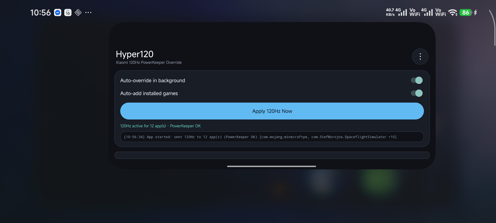
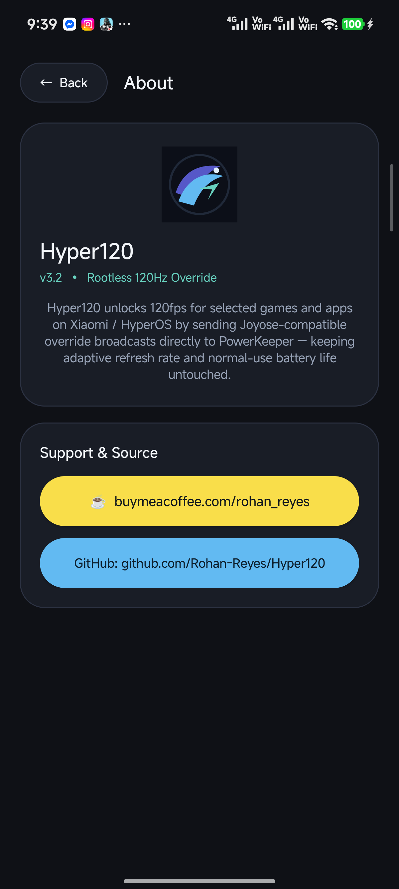
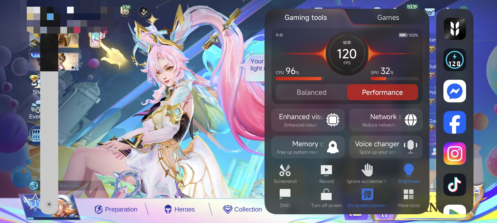
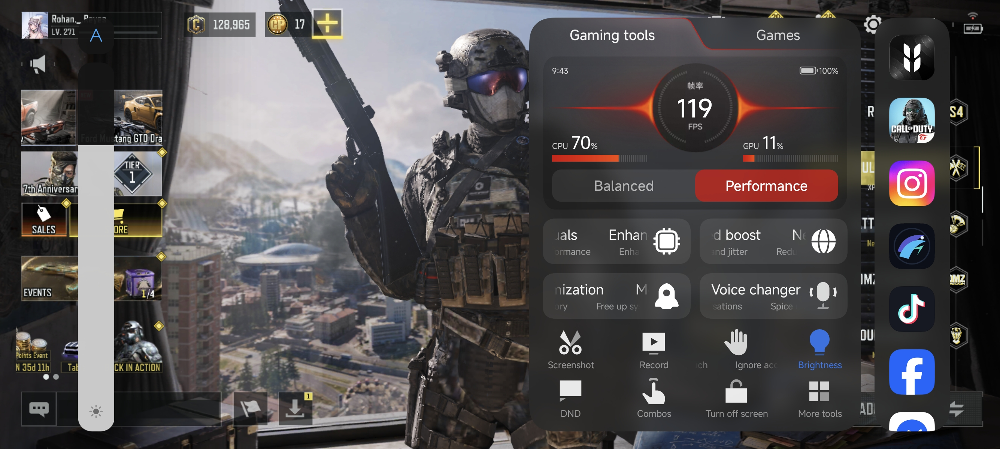
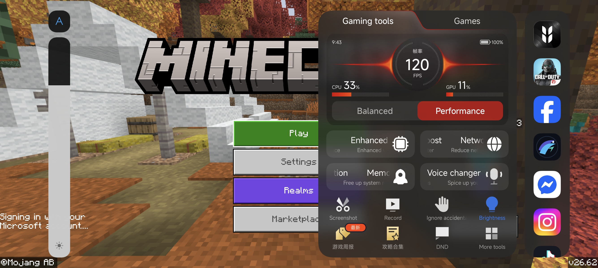
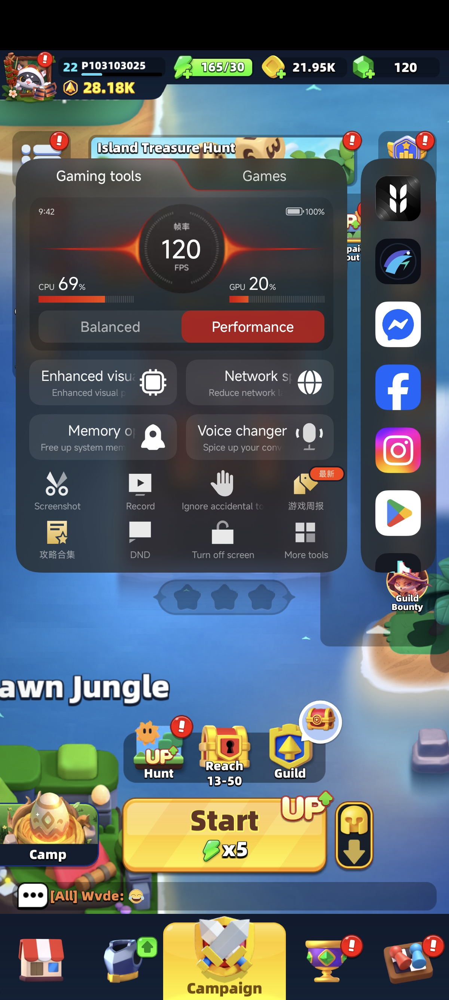

# Hyper120 — Social Media Posts & Assets

## Facebook Post

> **Tired of Xiaomi / HyperOS locking your games to 60Hz?** 🎮⚡
>
> I built **Hyper120 (v3.3)** — a **rootless** app that unlocks true **120Hz gaming** on Xiaomi, Redmi, and POCO phones **without** disabling PowerKeeper, rooting, or needing a PC after install.
>
> ✅ **No Root / No Shizuku / No PC needed** — just install the APK  
> ✅ **Auto-detects your games** (and newly installed ones too)  
> ✅ **Zero battery trade-off** — `PowerKeeper` and adaptive refresh rate (`60Hz/idle` in normal apps) stay 100% enabled  
> ✅ **Sticks across resets** while your screen is on  
> ✅ **Open source & free**  
>
> Tested on Xiaomi 14 (HyperOS / Android 16) with MLBB, CODM, Minecraft, Archero 2, and more.
>
> 🌐 **Website & Guide:** https://hyper120.aten-systems.site  
> 📦 **Download / Source (GitHub):** https://github.com/Rohan-Reyes/Hyper120  
> ☕ **Support the project (Buy Me a Coffee):** https://buymeacoffee.com/rohan_reyes  
>
> *(Tip: After installing, set Hyper120 → App info → Autostart ON & Battery saver → No restrictions so HyperOS doesn't kill it in the background.)*

---

## Reddit Post (`r/Xiaomi`, `r/HyperOS`, `r/AndroidGaming`)

**Title:**  
`[Open Source / No Root] Hyper120 v3.3 — Unlock 120Hz in games on HyperOS/MIUI without disabling PowerKeeper`

**Body:**

Most "120Hz fixes" for Xiaomi/HyperOS tell you to disable `com.miui.powerkeeper` or `joyose` via ADB, which breaks adaptive refresh rate and hurts standby battery life.

I made **Hyper120**, a lightweight rootless Android app that unlocks **120Hz** for your chosen games while keeping `com.miui.powerkeeper` and `is_smart_fps=1` **100% enabled** for normal apps.

### How it works
Instead of killing PowerKeeper, Hyper120 sends `com.xiaomi.joyose.OVERRIDE_GAME_FRESHRATE` (`override_freshrate=120`) to PowerKeeper to populate `mPrivGames` for the apps you select, and periodically refreshes it while the screen is on so HyperOS doesn't reset it back to 60Hz.

### Features
- **No root, no Shizuku, no PC required** after installing the APK
- **Auto-detects installed & newly installed games** (and remembers any game you manually uncheck)
- **Normal apps still drop to 60Hz/idle** via adaptive refresh rate
- **Starts on boot** (`BOOT_COMPLETED`)

### Verified on Xiaomi 14 (`houji`, Android 16 / HyperOS) with PowerKeeper enabled
- Before: `mActiveRenderFrameRate=60.000004` (`baseModeId=2`)
- After: `mActiveRenderFrameRate=120.00001` (`baseModeId=1`) with `fpsconfig mPrivGames={...=120}`

### Links
- **Landing page & install guide:** https://hyper120.aten-systems.site
- **GitHub & APK Releases:** https://github.com/Rohan-Reyes/Hyper120
- **Support / Buy Me a Coffee:** https://buymeacoffee.com/rohan_reyes

*(Note: On HyperOS/MIUI, enable **Autostart** and set **Battery saver → No restrictions** for Hyper120 in App info so it stays active in the background.)*

---

## Attached Photos (`assets/`)

### App UI
| Main App Picker | About & Support |
| :---: | :---: |
|  |  |

### In-Game 120Hz Screenshots
| Mobile Legends: Bang Bang | Call of Duty: Mobile |
| :---: | :---: |
|  |  |

| Minecraft | Archero 2 |
| :---: | :---: |
|  |  |
